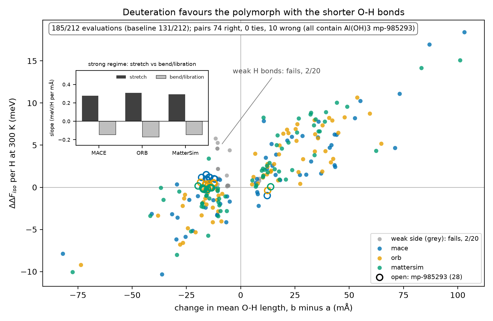
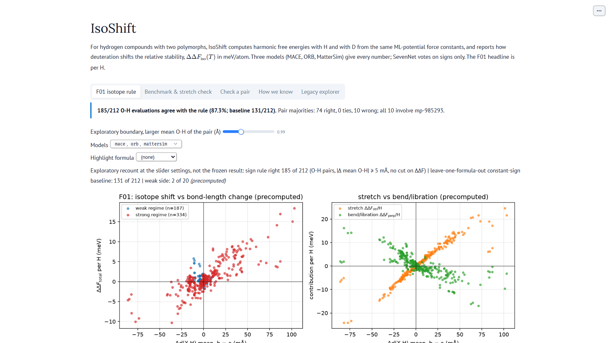
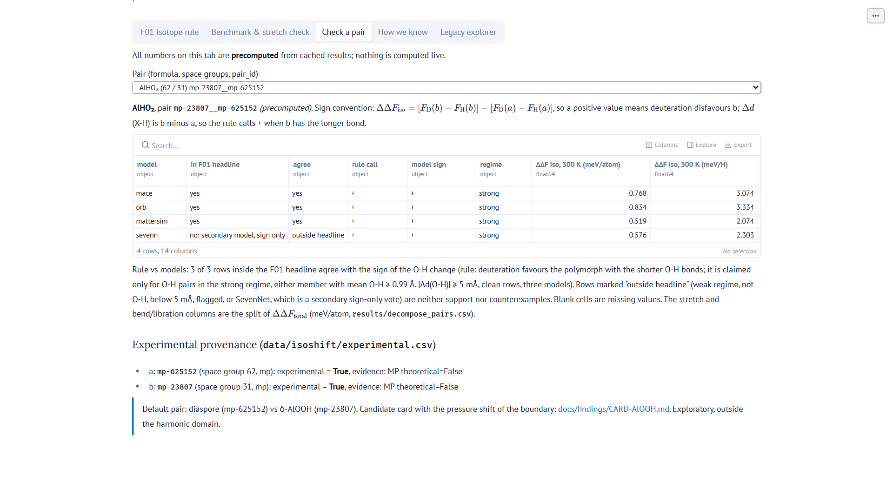
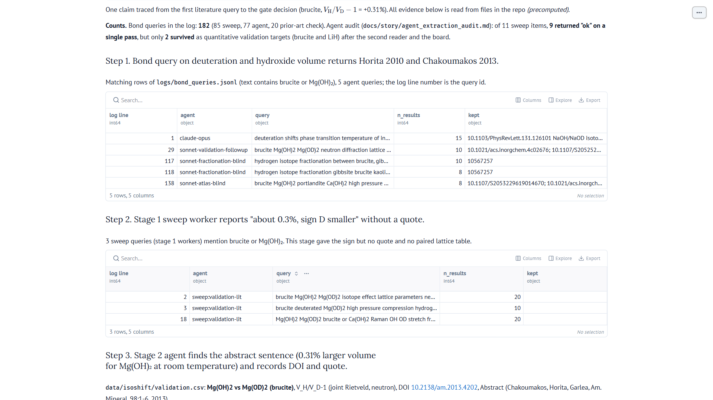
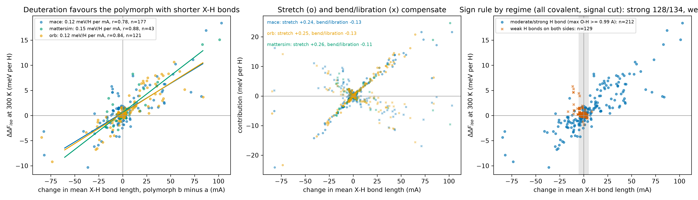
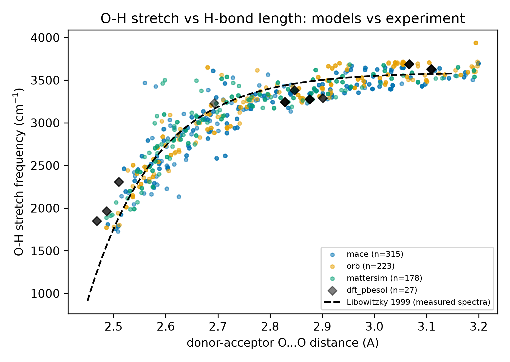

# IsoShift

IsoShift computes harmonic H and D phonon free energies of crystal polymorphs with three universal ML potentials and finds that deuteration favours the polymorph with the shorter O-H bonds in 185 of 212 evaluations with moderate-to-strong hydrogen bonds (constant-sign baseline 131), fails with weak ones (2 of 20) and has one Al(OH)3 counterexample by pair majority; no measurement has tested this rule directly. Two would: D/H partitioning between coexisting polymorphs (exact for one H site type such as AlOOH; [M02](docs/math/M02-bigeleisen-bridge.md) gives the correction otherwise), and matched reversed-bracket AlOOH/AlOOD runs on the diaspore to δ-AlOOH transition, where the models predict a pressure about 1 GPa higher for AlOOD (exploratory sign prediction).

> **Check it in 60 seconds.**
> Headline numbers, CPU only: `python -m venv .venv`, activate it, `pip install -r requirements-judge.txt` (five packages, no torch, about two minutes), then `python -m src.isoshift_event.rule_cv`. The `oh_unfiltered_strong` line prints right 185, n 212, baseline 131 and pair majorities 74 right, 0 ties, 10 wrong. Setup: [How to run](#how-to-run).
> App, no GPU: `marimo run app/isoshift_app.py` (inside the venv); the frozen banner and the tabs are at the top.
> Evidence index: [docs/INDEX.md](docs/INDEX.md). Judge FAQ: [docs/FAQ.md](docs/FAQ.md).
> Video (3:30): https://youtu.be/3gE5nxhLo80

**Main finding (F01).** Across 220 hydrogen-compound polymorph pairs screened with three universal ML potentials, the harmonic H/D free-energy difference at 300 K changes by 0.11 to 0.13 meV per H for each mÅ difference in mean X-H length, a stretch term about half cancelled by bend and libration. When at least one polymorph has a mean model O-H length of 0.99 Å or more (a model-derived boundary for moderate to strong hydrogen bonds, chosen after inspecting the data), deuteration favours the polymorph with the shorter O-H bonds in 185 of 212 O-H model evaluations with |Δ mean O-H| ≥ 5 mÅ (84 pairs, 28 formulas), against 131 of 212 for a constant-sign baseline fitted on leave-one-formula-out training folds. By model majority 74 pairs are right and 10 are wrong, and all 10 wrong pairs contain one Al(OH)3 structure, mp-985293.



*O-H pairs with |Δ mean O-H| ≥ 5 mÅ. Regime by the larger mean model O-H of the pair; the 0.99 Å boundary was chosen after inspecting the data (nested re-choice picks 1.00 Å in 30 of 31 folds). Open markers: evaluations involving Al(OH)3 mp-985293, kept in the counts. Evaluations share structures and models.*

How to read it: points in the upper right and lower left follow the rule; a positive ΔΔF_iso means deuteration destabilises polymorph b. A shorter O-H bond goes with a weaker hydrogen bond, so the rule says deuteration favours the polymorph whose hydrogen bonds are weaker.

**How to test it.** No polymorph isotope free energy has been measured. Measured D/H fractionation between two coexisting polymorphs constrains their isotope free-energy difference through ΔΔG_iso = n_H k_B T ln α + R, with α the a to b fractionation factor of [M02](docs/math/M02-bigeleisen-bridge.md) and R = 0 for one H site type with no H-H coupling, as in diaspore and δ-AlOOH; the boundary shift then follows from ΔΔG_iso and ΔV. For the AlOOH card, matched reversed-bracket runs on AlOOH and AlOOD test the sign of the pressure shift.

One-page summary: [docs/story/writeup.md](docs/story/writeup.md) (long version: [writeup_long.md](docs/story/writeup_long.md)). Evidence index: [docs/INDEX.md](docs/INDEX.md).


**The app (marimo, cached results only).**





## Why

Two groups of people deuterate crystals and would like to know what it does to phase stability.

1. Neutron-scattering crystallographers deuterate samples to reduce incoherent background. A deuterated sample is often read as a stand-in for the hydrogenous one, yet in δ-AlOOH deuteration moves the measured proton-disorder transition from 9.0 to 13.4 GPa (Sano-Furukawa et al. 2018), a different transition from the diaspore boundary IsoShift models.
2. Researchers who use D2O or D2 in synthesis to target metastable phases need to know which polymorph pairs are sensitive to the isotope at all.

Possible users: high-pressure neutron groups that use δ-AlOOD and ε-FeOOD as stand-ins for hydrous mantle phases (the models give the AlOOD boundary about 1 GPa higher, exploratory sign), and isotope geochemists comparing D/H partitioning between coexisting minerals (M02, with R stated). No group has used these results yet.

The effect is small (meV per atom) and static-energy errors of the models are larger. That is why the main output is the isotope double difference of free energies, which does not depend on the static energy gap between the polymorphs.

## Method

1. Born-Oppenheimer force constants do not depend on nuclear mass. One phonon calculation per structure therefore gives the harmonic and quasi-harmonic free energies for both H and D: the dynamical matrix is rebuilt with the D mass and diagonalised again. Formulas are in `docs/math/M01-isotope-formulas.md`.
2. Three universal machine-learned interatomic potentials (MLIPs), MACE, ORB and MatterSim, give every number. A fourth, SevenNet, votes on signs only, because its LiH TO(H) frequency is 15.3% off experiment (see Results). Exact checkpoints are in `DATA_SOURCES.md`. Phonons come from phonopy. The spread between models is reported as model spread.
3. Polymorph pairs are built from Materials Project and JARVIS-DFT: same composition, different structure, hydrogen present, no carbon, up to 32 atoms. The current set has 836 structures and 965 pairs (`data/isoshift/pairs.csv`, method in `data/isoshift/PAIRS.md`). Energies from the two databases are never subtracted from each other. Of the 965 pairs built, 220 (63 formulas) have clean harmonic results for covalent X-H bonds in at least one model and give the slope; 84 of those are O-H pairs in the headline sign test ([pipeline counts](figures/fig2_pipeline_counts.png)).
4. Validation uses measured volume and lattice isotope effects (see Results).

Sign convention: ddF_iso = [F_D(b) - F_D(a)] - [F_H(b) - F_H(a)] for polymorphs a and b. Rules for ranking and reporting are in `PLAN.md` (P3, P13 to P15).

## Glossary

* **Polymorph:** one of two or more crystal structures of the same compound.
* **Isotope effect:** the change in a property when H is replaced by D.
* **MLIP:** a universal machine-learned interatomic potential, trained on DFT data across the periodic table; it gives forces at a small fraction of the DFT cost.
* **Harmonic, QHA:** vibrational free energy from phonons at fixed geometry; the quasi-harmonic approximation (QHA) adds the volume dependence. Neither includes anharmonicity or tunnelling.
* **ΔΔF_iso (ddF_iso):** the isotope double difference above. Positive means deuteration destabilises polymorph b. The static energy gap between a and b cancels in it.
* **mÅ:** 0.001 Å. Typical O-H length differences between polymorphs are a few mÅ.
* **Libration:** the hindered rocking of an O-H group. Together with bending it opposes the O-H stretch in ΔΔF_iso.
* **LOFO:** leave-one-formula-out cross-validation. Each formula is held out in turn and the baseline or threshold is fitted on the rest.
* **Evaluation:** one pair computed with one model. **Clean:** quadrature and direct isotope free energy agree within 0.01 meV/atom per structure.

## How AI was used

Each step of the loop is logged so it can be checked.

1. Valency Bond literature agents find the experimental validation numbers (value, unit, temperature, pressure, DOI). Every query, its purpose and what was kept are in `logs/bond_queries.jsonl`: 182 rows, 85 sweep rows plus 97 agent rows (20 prior-art checks, 26 atlas-test queries plus one re-log, 9 ice-boundary queries, 41 other validation lookups; recount with `python -m src.isoshift_event.bond_counts`). Of 11 sweep items, 9 came back 'ok' in one pass and 2 became quantitative targets, and the board caught a reference value off by 2x. Not every measured value came through Bond: the [extraction audit](docs/story/agent_extraction_audit.md) gives each cited source with its log line numbers or 'no matching log row'.
2. A second model cross-checks every extracted row against its source (`data/isoshift/validation.csv`).
3. Every formula in the code went through `mathcheck`: two separate derivations by two models, a numerical comparison, then reconciliation (`docs/math/M01-isotope-formulas.md`).
4. The MLIP ensemble computes the free energies (`src/isoshift_event/`).
5. Hard decisions went to a multi-model board that answers blind, with the chair writing the record including dissent. Records are in `docs/decisions/`. The gate decision (`01-gate.md`) shows one model arguing for failure and the chair overruling it on stated grounds.
6. A second model (Codex) reimplemented the isotope double difference without our code. F06 is a nine-row implementation check, not a physics test.
7. Opus integrates the results, assigns work and makes the final calls. The task ledger is `state/LEDGER.md`, the workflow is described in `docs/WORKFLOW.md`.

## Results

Framing: H/D vibrational free energies validated against measured volume/lattice isotope effects (brucite, LiH); polymorph ddF_iso and transition shifts are exploratory ensemble predictions.

Volume isotope effect VIE = 100 (V_H / V_D - 1), quasi-harmonic, four models and four treatments of the imaginary modes (details in `docs/decisions/00-brucite-imaginary-modes.md` and `01-gate.md`, data in `results/validation/volume_isotope.csv`).

| system | computed | measured | comment |
|---|---|---|---|
| brucite Mg(OH)2 | +0.19 to +0.44% | +0.31% (Chakoumakos 2013, doi 10.2138/am.2013.4202) | sign right in 4 of 4 models under every treatment |
| LiH vs LiD | +1.02 to +1.27% | +0.81% (+1.04% from an alternative source; the two sources disagree) | sign right in 4 of 4, magnitude overestimated |
| ice XI proxy | negative in 4 of 4 | negative (anomalous) | sign reproduced, magnitude about 4 to 11 times too large; reported only |
| portlandite Ca(OH)2 | no clean result | no clean experimental H/D pair | null check, reported as uninformative |

Implementation checks (equal masses give zero shift, H/D swap flips the sign, classical-limit decay, LiH Gamma TO frequency) are in `results/validation/tier_a.csv`. SevenNet's LiH TO(H) is 15.3% off experiment, so it is excluded from quantitative claims and kept in sign votes and model spread.

### F01: an isotope rule for polymorph stability (`docs/findings/F01-xh-length-rule.md`)

The headline figure is at the top. Details figure, all clean covalent rows and four models (SevenNet drawn for comparison only):



* The isotope double difference per H is linear in the change of mean X-H bond length between the polymorphs: slope 0.11 (MACE), 0.12 (ORB), 0.13 (MatterSim) meV/H per mÅ over all clean covalent rows of the screen; r 0.76 to 0.84.
* Mechanism, from a mode-resolved mass integral: over all clean covalent rows the X-H stretch term (+0.24 to +0.26 meV/H per mÅ) is about half cancelled by bending and libration (-0.12 to -0.14); in the O-H strong regime of the headline it is +0.28 to +0.31 against -0.15 to -0.17 (50 to 56% cancelled, the inset of the headline figure).

The 0.99 Å boundary was chosen after inspecting the pre-freeze data and is kept for the frozen result. Re-choosing it inside each leave-one-formula-out training fold picks 1.00 Å in 30 of 31 folds and 0.99 Å only in the fold that holds out Al(OH)3, and gives 183 of 210 held-out evaluations right against a baseline of 131. In that Al(OH)3 fold the rule scores 8 of 28 against a baseline of 19, so a sharp, universal boundary is not established; the cross-validation covers the threshold value, not the choice of regime variable, grid or eligibility cuts. The 10 wrong pairs all contain mp-985293 (P2₁2₁2₁, listed by the Materials Project as experimental, no imaginary modes in any of the three models), whose mean model O-H of 0.996 to 0.999 Å sits just above the boundary while its mean O...O contacts are short (2.77 to 2.82 Å). In these pairs the stretch term has the predicted sign, but bend and libration cancel 95 to 132% of it instead of about half: MACE calls 0 of 10 right, ORB 0 of 9 and MatterSim 8 of 9, with every MatterSim value at |ΔΔF| ≤ 0.26 meV per H. Without any threshold the rule holds in 187 of 232 O-H evaluations (81%). Below the boundary it fails (2 of 20 evaluations, 13 pairs, 7 formulas). In the O-H strong regime the fitted total slope is 0.13 to 0.15 meV per H per mÅ, with bend and libration cancelling 50 to 56% of the stretch slope. A structure-only version using mean O...O ≤ 2.93 Å is weaker (187 of 241 evaluations with |ΔΔF| > 0.1 meV per H, 78%, against 61%). The evaluations share structures and models, the three potentials are separate models, not independent validations, and no polymorph isotope free energy has been measured to test the rule directly. The full scan and the per-fold ledger are in `results/F01_cv.json`.

### F03: the stretch ingredient matches measured spectra (`docs/findings/F03-stretch-vs-experiment.md`)



For O-H donors with model O...O distances of 2.50 to 2.80 Å, the harmonic Γ-point stretch frequencies follow the slope of the empirical Libowitzky ν(OH) vs O...O correlation with slope ratios of 0.91 (MACE), 0.92 (ORB) and 0.92 (MatterSim), structure-bootstrap 95% intervals 0.67 to 1.07, 0.82 to 1.01 and 0.81 to 1.02 (`results/stretch_check_summary.json`). Above 2.80 Å the ratios are 0.67, 2.61 and 1.46, so ORB and MatterSim are too steep there, and the F01 strong regime reaches O...O of about 2.93 Å. This is a consistency check on the stretch term, not a validation of isotope free energies.

### F02: blind volume isotope test (`docs/findings/F02-blind-test.md`)

Predictions committed before the measured values were read (`docs/predictions/P01_volume_isotope_blind.csv`, commit 0fffc54). Mixed: alpha-AlH3 right sign but 1.3 to 1.5x too large; GaOOH and beta-CrOOH wrong sign against low-quality references; brucite and LiH right. The misses are in the strong-H-bond regime, where harmonic and quasi-harmonic physics omits Ubbelohde-type proton anharmonicity. F02 does not test F01.

### Candidate card: diaspore to delta-AlOOH (`docs/findings/CARD-AlOOH.md`)

Deuteration destabilises delta-AlOOH relative to diaspore by +0.5 to +0.8 meV/atom (three models) and, in an exploratory QHA prediction at 300 K, raises the transition pressure by +1.13 GPa (ORB) and +1.33 GPa (MACE) (+0.3 to +0.4 GPa from 0 GPa geometries). The two models place the boundary 4.2 GPa apart but agree on the shift; the sign is the prediction, and proton disorder in delta-AlOOH lies outside harmonic physics. The MACE H root is extrapolated below the 10 to 20 GPa fit grid, and the measured boundary is crossed at high temperature, far from the 300 K absolute values, so only the sign of the shift is claimed.

### F04: differential spectroscopy (`docs/findings/F04-differential-spectroscopy.md`)

In one predeclared literature pair (goethite to ε-FeOOH) the O-H stretch falls and the assigned O-H bend rises, as predicted: nominal shifts are about -260 cm⁻¹ (from the midpoint of a 2600 to 3100 cm⁻¹ band, so anywhere from -511 to -11 cm⁻¹) against -273 predicted, and +290 against +195 cm⁻¹. The diaspore to δ-AlOOH pair was inconclusive. This is consistent with the sign of the compensating bend shift at the zone centre, not a measurement of its size or of the compensation fraction; the measured bend/stretch shift ratio (about 1.1) exceeds the model median (0.7).

### F05: blind test against measured mineral D/H fractionation (`docs/findings/F05-fractionation-test.md`)

The same H/D free energies give reduced partition function ratios, so mineral-mineral differences of measured mineral-water D/H fractionation test them without any water model. Predictions for 118 structures were committed before the data were read (`docs/predictions/P04_fractionation_blind.csv`, f3ac0ac). The comparison rule (`docs/predictions/P04_comparison_rule.md`) was committed together with its result (90ad4cd), not before it (timing note in F05). Result: the sign of every scored difference (6 of 6) and the order brucite > goethite > manganite are right in all three models, and the mineral with the longer O-H bonds takes up less deuterium, as F01 implies. The magnitudes are 5 to 10 times too large and the brucite-goethite temperature trend has the wrong sign, so the preset verdict is "ordering only": harmonic partition functions of O-H minerals are known to be biased by stretch anharmonicity.

### F06: reimplementation without our code (`docs/findings/F06-independent-replication.md`)

A second model (Codex) reimplemented the isotope double difference and its stretch/bend split from the cached force constants without reading our code, using a different quadrature and q-mesh. It reproduces our numbers to 1e-9 meV/atom with 9 of 9 signs: the implementation is checked; the force fields are not.

### F07: blind ice boundary test, a failed prediction (`docs/findings/F07-ice-boundary-test.md`)

Model H2O to D2O shifts of three ice boundaries were committed before any measured D2O boundary was read (`docs/predictions/P05_ice_boundary_blind.md`, bec68d7). Ih-II and Ih-III have the wrong sign in 3 of 3 models; II-III is right. Both failures involve ice Ih, which the models treat through the ordered ice XI proxy; ice XI is 7 to 9% too dense in all three models. Test: the same calculation with a proton-disordered Ih model or anharmonic free energies.

### Benchmark

Four models vs DFT phonons (PBEsol, 40 MDR phonondb entries, 36 for SevenNet, DFT geometries): isotope ZPE difference MAE 0.7 to 1.5 meV per H (ORB 0.7, SevenNet 1.1, MatterSim 1.3, MACE 1.5), 300 K H/D free-energy difference MAE 0.5 to 1.1 meV per H, X-H stretch MAE 28 to 45 cm-1 (`results/benchmark/summary.csv`, [figure](figures/fig3_benchmark.png)).

## Beyond the headline (post-freeze addendum, 22 Oct)

Everything in this section was computed after the compute freeze, each with its prediction or scoring rule committed before the result (decision 08). None of it changes the frozen headline above, and none of it is in the video or the headline figure. Commits and files: [docs/INDEX.md](docs/INDEX.md).

* **Why the 10 wrong pairs are wrong (F09, computed; one predeclared test failed).** In all 28 evaluations with mp-985293 the stretch term keeps the F01 sign at every temperature computed; bend and libration flip the total at low temperature. Above a model-dependent crossover (MatterSim mostly below 300 K, ORB 317 to 406 K, MACE 431 to 506 K) all 28 follow the rule. The predeclared zero-point weighting explanation failed (H1, 98 of 212), so no mechanism for the crossover is claimed. This is harmonic at fixed geometry, and several of these hydroxides decompose before the upper temperatures. Test: anharmonic or path-integral isotope free energies of the mp-985293 pairs.
* **Boehmite vs diaspore (F12, tested against measurement, inconclusive).** The models predict that D prefers boehmite, the shorter O-H phase. Measured mineral-water fractionation (Graham et al. 1980, read from the Chacko, Cole and Horita 2001 compilation) agrees in sign at 380 °C in 3 of 3 models, but the predeclared rule scores it inconclusive: the source gives no uncertainty and the diaspore value comes from 25% exchange. Test: a fully exchanged boehmite and diaspore fractionation measurement with stated uncertainty.
* **Goethite to ε-FeOOH (card, exploratory prediction).** Deuteration raises the transition pressure by +0.2 to +0.5 GPa in the models; q-mesh sensitivity is as large as the signal, so only the sign is claimed. Test: matched reversed-bracket runs on FeOOH and FeOOD.
* **Angle-refined rule (F08, failed prediction).** Adding the O-H...O angle did not fix the mp-985293 pairs: it failed its predeclared SevenNet test and does not beat F01 on the three models. Test: a held-out set that contains high-compensation pairs.
* **Isotope atlas (F10, exploratory map, untested).** A structure-only map of 1796 Materials Project O-H polymorph pairs gives the predicted deuteration preference from database geometry in 53 s on one CPU core. Its blind literature test found no scorable measurement (0 of 26 rows; most are order-disorder or tunnelling transitions, which the rule excludes). Test: any measured D/H fractionation or isotope-shifted boundary between two ordered polymorphs in the map.
* **Prospective held-out test (P10, F11).** Predictions for experimental pairs never computed before (111 primary rows, 42 pairs, 20 formulas) were committed after relax-only geometry and before any phonon job (eb61ccf). F11 prospective test: FAIL against its predeclared bar; see [docs/findings/F11-prospective-test.md](docs/findings/F11-prospective-test.md).

### Prediction scorecard

Every prediction file, the commit that fixed it before its data or result, and the outcome. P06 to P11 are post-freeze (22 Oct) and belong to this addendum; P01 to P05 are pre-freeze. Details: [docs/INDEX.md](docs/INDEX.md).

| id | what | commit | outcome |
|---|---|---|---|
| P01 | volume isotope effects, 13 known H compounds | 0fffc54 | F02: mixed |
| P02 | O-H stretch and bend shifts, diaspore to δ-AlOOH and goethite to ε-FeOOH | da560cf | F04: sign-level, one pair (goethite to ε-FeOOH); diaspore pair inconclusive |
| P03 | stretch and bend shifts, manganite to groutite | c990f11 | F04: inconclusive |
| P04 | harmonic mineral D/H fractionation, 118 structures | f3ac0ac (scoring rule 90ad4cd, committed with its result) | F05: ordering only |
| P05 | H2O to D2O shift of three ice boundaries | bec68d7 | F07: failed (Ih-II and Ih-III wrong sign; II-III right) |
| P06 | refined rule with the O-H...O angle | cdb32da | F08: failed |
| P07 | deep-Earth isotope draft | 08a9b1f | parked per decision 08; exploratory, not scored |
| P08 | structure-only atlas, 1796 pairs | d991991 | F10: nothing scorable (0 of 26) |
| P09 | temperature-resolved F01, H1 to H4 | d03f8d2 | F09: H1 failed |
| P10 | prospective held-out test on new pairs | eb61ccf | F11: failed (16 of 111) |
| P11 | boehmite vs diaspore D/H fractionation | 184fbee | F12: inconclusive (sign agrees) |

## Prior work

The competition between O-H stretch and bend zero-point energies that underlies F01 is known: McKenzie et al. derived it for hydrogen-bond isotope fractionation (J. Chem. Phys. 140, 174508 (2014), 10.1063/1.4873352; J. Chem. Phys. 143, 044309 (2015), 10.1063/1.4927391), Li, Walker and Michaelides showed competing quantum effects whose net sign depends on H-bond strength (PNAS 108, 6369 (2011)), and Zhou, Kye and Harbison explained isotopomeric polymorphism in molecular crystals by zero-point energy differences (2004, 2006). The Ubbelohde geometric isotope effect is a related geometry effect. Bourgeois et al. (2018, J. Phys.: Condens. Matter, 10.1088/1361-648X/aad259) computed harmonic H, D and T effects on gas-solid hydride formation with DFT for 115 metal hydrides; there the zero-point energy of the H2 or D2 gas dominates. Du, He, Shen, Ye, Zeng, Zhang, Kapil and Fang ("Isotope Effects at Classical Cost through Mass-Differentiable Machine Learning", arXiv:2610.11325, 8 Oct 2026) learn a mass-dependent path-integral free-energy surface (iso-EPIGS) and apply it to liquid water and one oxalic acid crystal; it is a method for single systems, not a polymorph survey.

## What is new

IsoShift's contribution is the systematic polymorph-stability version of that competition, its slope, and where it holds and fails in three models, over 220 crystal pairs. Solid-solid polymorph differences cancel the gas terms that dominate hydride formation, and the screen spans hydroxides, oxyhydroxides, borohydrides, alanates and hydrides. It adds a model-derived regime boundary chosen after inspecting the data (mean O-H 0.99 Å, O...O about 2.93 Å), a structure-only O...O sign predictor that needs no phonons (78% vs 61% baseline), and a named experiment that would test the rule (M02). The three ML models share PBE-level training data, so their agreement is not a validation. A literature search (logged) found no earlier survey of H/D free-energy differences across polymorph pairs of the same compound. The claim is this demonstrated extension to solids, not priority over earlier work.

## Limitations

* Harmonic and quasi-harmonic physics only. Anharmonic effects are not included. Pairs where most of ddF_iso comes from X-H stretches are flagged as anharmonic-sensitive.
* All four MLIPs are trained on PBE-level data and share its biases. Four related models are not four independent validations.
* Model spread is the range across models. It is not a confidence interval.
* The volume isotope effect tests the volume derivative of F_H - F_D inside one phase. It does not validate polymorph double differences or transition shifts. The one double difference we checked, alpha/gamma MgH2, splits in sign across models.
* Brucite has an imaginary H branch (up to 0.8% of modes). It is excluded from F_vib and its effect is bounded by a four-treatment bracket, not computed anharmonically. Relaxed volumes are off: brucite 5.4 to 7.2% too large, ice 6.5 to 7.9% too dense.
* No nuclear tunnelling and no order-disorder physics. Negative controls are labelled by mechanism: tunnelling (KDP, delta-AlOOH), configurational disorder (KOH, NH4Cl), plus NaOH/NaOD. They test stated limits and are not required to fail.
* F11, a post-freeze prospective test on pairs never computed before, failed its predeclared bar (16 of 111 right; 87 rows lost to the predeclared numerical rules; on the 24 clean rows the rule got 16 and a constant guess 19). Transfer of F01 to new pairs is not shown.
* The DFT benchmark is per structure. No DFT value of a polymorph isotope double difference was computed.
* 'Clean' means the two free-energy routes agree within 0.01 meV/atom; it does not certify relaxation convergence, dynamical stability or robustness to imaginary modes. 42 of 212 headline evaluations carry a classical-limit flag (decision 07: a diagnostic, not a filter).
* Cross-validation covers the 0.99 Å threshold, not the choice of regime variable, grid or eligibility cuts.
* Experimental usefulness is untested. The screen excludes carbon, so drug and organic polymorphs are out of scope.
* Bond-assisted extraction needed source checking: of 11 sweep items, 9 came back 'ok' in one pass and 2 became quantitative targets, and the board caught a reference value off by 2x. These are screening outcomes, not an extraction accuracy.
* The marimo app inspects cached results for screened pairs. It does not compute phonons and does not predict arbitrary pairs.
* Open items are listed in `docs/decisions/01-gate.md`.

## How to run

Needs Python 3.12 (tested with 3.12.10). On Windows, clone into a short folder path: pip hits the long-path limit in deep folders. Commands below use the Windows venv layout (`.venv/Scripts/`); on Linux or macOS use `.venv/bin/`.

```
python -m venv .venv
.venv/Scripts/pip install -r requirements.txt            # MACE and ORB, CPU torch from PyPI
# GPU (CUDA 12.4): .venv/Scripts/pip install torch==2.6.0 --index-url https://download.pytorch.org/whl/cu124
# SevenNet and MatterSim need e3nn>=0.5 and live in a second environment:
python -m venv .venv-sevenn
.venv-sevenn/Scripts/pip install -r requirements-secondary.txt
```

Check the headline in one command (a few seconds, CPU only). It recomputes `results/F01_cv.json` from the frozen `results/decompose_pairs.csv` and prints `oh_unfiltered_strong {'right': 185, 'n': 212, ...}` with pair majorities 74 right, 0 ties, 10 wrong:

```
.venv/Scripts/python.exe -m src.isoshift_event.rule_cv
```

Tests (the test suite expects the venv at `.venv` in the repo root; the DFT benchmark test skips when the git-ignored MDR data is absent):

```
.venv/Scripts/python.exe -m pytest -q -m "not live"
```

Figures. These overwrite the files in `figures/`:

```
.venv/Scripts/python.exe reproduce_figures.py                    # fig1 to fig3
.venv/Scripts/python.exe -m src.isoshift_event.fig_headline      # headline figure and caption
.venv/Scripts/python.exe -m src.isoshift_event.fig_rule          # fig4, all rows
```

Screen, analysis and validation (the screen needs a GPU):

```
python -m src.isoshift_event.pairs                 # build structures.csv and pairs.csv
python -m src.isoshift_event.screen --help         # restartable per-structure H/D screen
python -m src.isoshift_event.analysis --top 10     # ensemble audit, writes results/candidates.csv
python -m src.isoshift_event.validate --help       # QHA volume isotope effect runs
python -m src.isoshift_event.sanity mace,orb       # tier A checks
```

App (reads cached results, no GPU needed):

```
.venv/Scripts/python.exe -m marimo run app/isoshift_app.py
```

See `app/README.md` for the data layout the app reads.

## Prior work and event work

Declared for the hackathon. The full list with commits and timestamps is in `docs/PROVENANCE.md`.

Before the event (git tag `pre-event-baseline`, commit a5aff16, 21 Oct 2026 14:19 +0300):

* `harness/`, a generic LLM command-line wrapper, parallel runner and OpenAlex client.
* `isoshift/`, the topic harness: MLIP calculators, phonon mass override, QHA, comparison utilities, and a persistent GPU worker pool (`isoshift/pool.py`, `isoshift/worker.py`, `tests/test_pool.py`).
* Python environment, feasibility studies in `prep/`, planning and review documents in `docs/`, and prefetched data (validation structures, DFT phonon sets) in `data/isoshift/`.

During the event (21 Oct onward):

* Everything in `src/isoshift_event/` and `app/`: pair builder, screen driver, validation and QHA runs, sanity checks, benchmark against DFT phonons, analysis, refinement, provenance, convergence checks, Bond log.
* `data/isoshift/validation.csv`, pairs, structures, `results/`, decision records, math checks and the ledger.
* Two event-time changes to pre-event code: `isoshift/pool.py`, commit 62f1fde, which handles Windows file-replace collisions; and `harness/llm.py`, commit d250b20, which gives the headless Gemini council call read-only repo access (`--add-dir`; Can approved, 21 Oct 22:10).

## License and citation

MIT, see `LICENSE`. Citation metadata is in `CITATION.cff`. Data and model licences are in `DATA_SOURCES.md`.
